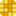

# <picture><source media="(prefers-color-scheme: dark)" srcset="logo-dark.svg"></picture>

> I once paid for Adobe, then fell for open-source Inkscape, but at heart I've always loved lightweight tools, ideally ones that run right in the browser; now that AI is here, we can hand-craft the manual parts of our workflows exactly the way we want.

A tiny SVG editor for scientific figures, in one HTML file. Touch up figures from ggplot2, Inkscape or Adobe Illustrator in your browser or in TBtools. As a single file it may also open in the built-in viewers of VS Code or RStudio (untested). Nothing is uploaded.

**Live: https://www.svguest.online** (also at https://jieqianghe.github.io/svguest/)

[TBtools-II](https://github.com/CJ-Chen/TBtools-II) users can use `svguest.plugin` directly. Inside TBtools, SVG Chat can use TBtools' model for free, without an API key, or your own paid ChatGPT plan (Sign in with ChatGPT).

## The name

“Another roof, another proof.” Paul Erdős (1913–1996) travelled with a suitcase, staying with fellow mathematicians and working on proofs together. svguest borrows that spirit, and its logo: a small guest with a briefcase that moves in for a while, as a tab in your browser or a plugin in TBtools, and works on your figures with you.

https://github.com/user-attachments/assets/a6501747-b90a-4e66-8a97-4ff731155efa

## Acknowledgements

Thanks to <a href="https://github.com/CJ-Chen/TBtools-II">TBtools-II</a> and its author, Chengjie Chen (<a href="https://github.com/CJ-Chen">@CJ-Chen</a>), for hosting svguest as a plugin and for opening TBtools' model to SVG Chat, and to <a href="https://bioanno.com/index">BioAnno</a> for its support.

&nbsp;&nbsp;&nbsp;&nbsp;

Do not use or trace figures from BioRender, Figdraw, icon sites, papers or textbooks and publish them as your own; when you use others' graphics, follow their license, credit the source, and obtain permission where required.
